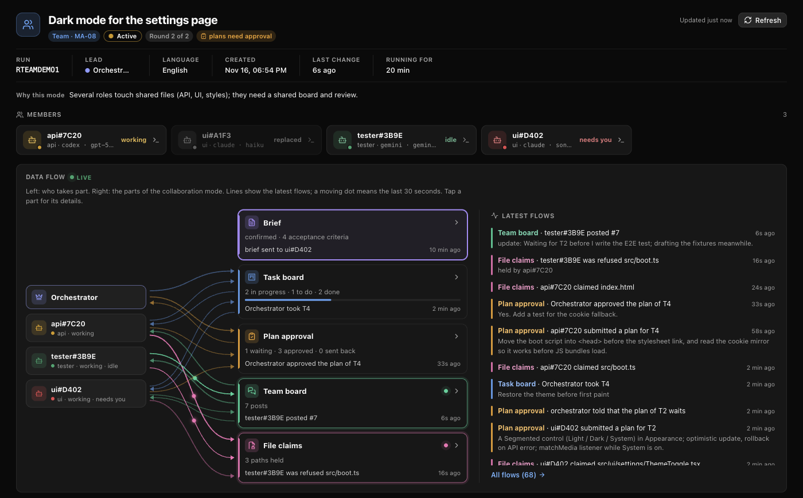
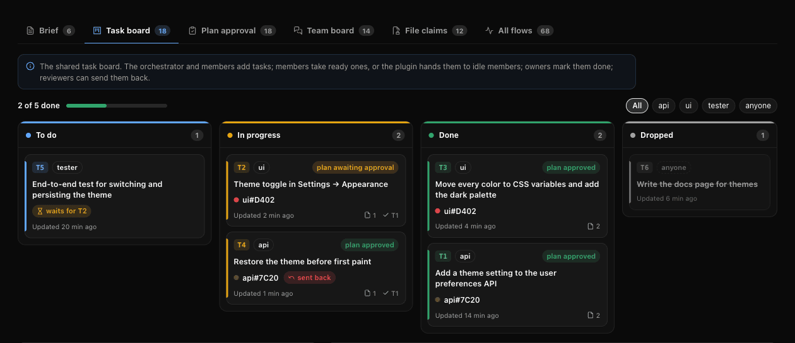
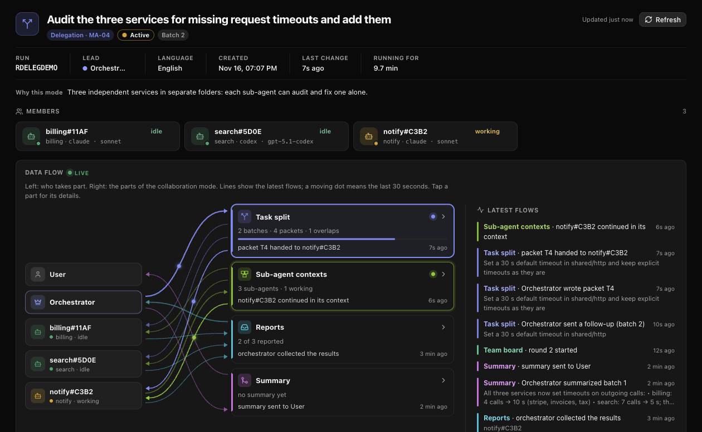
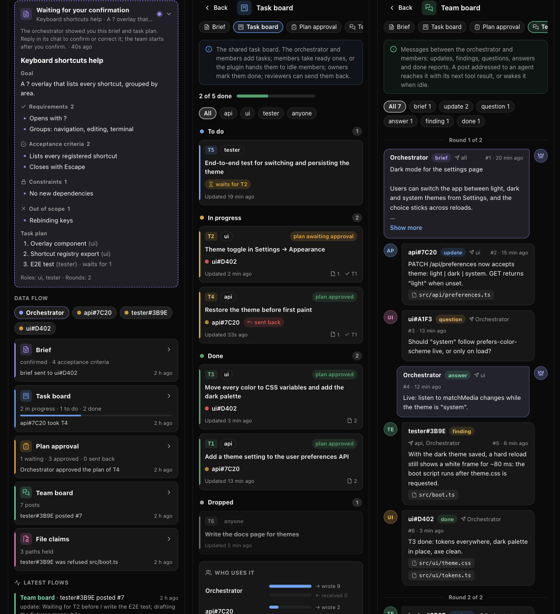
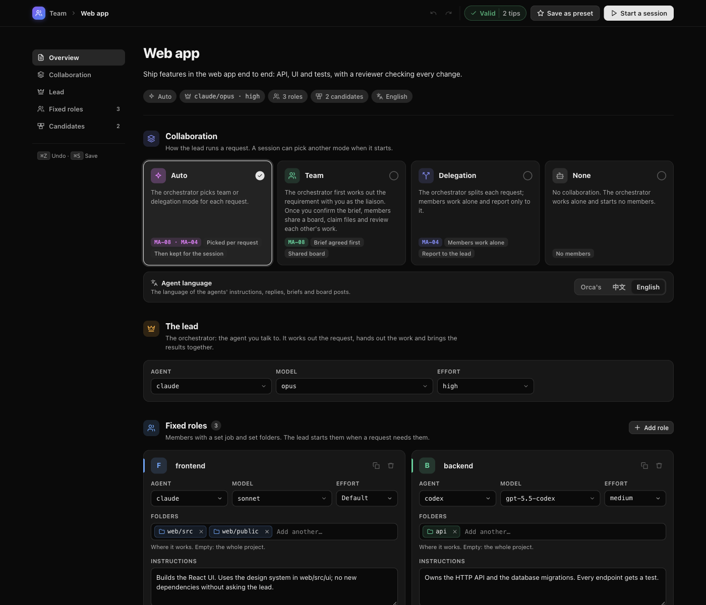
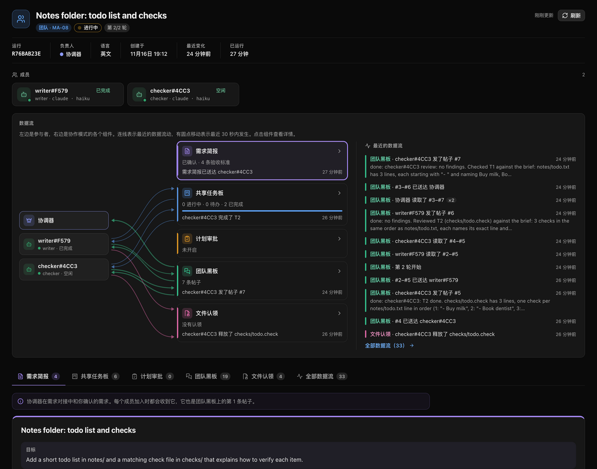
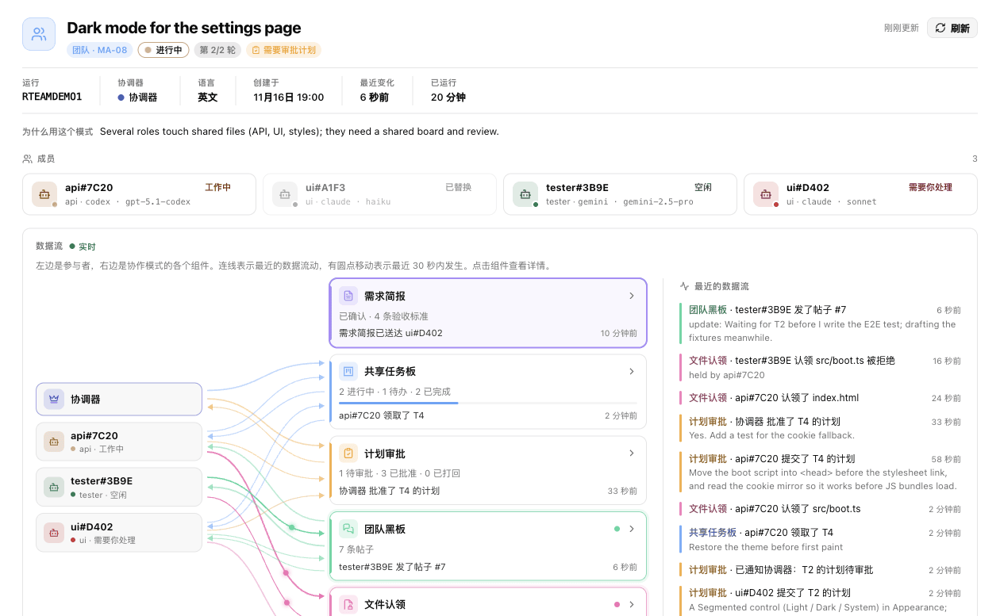
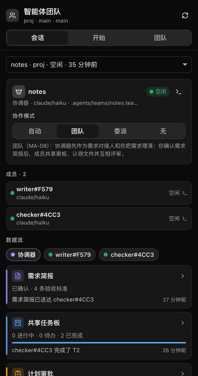
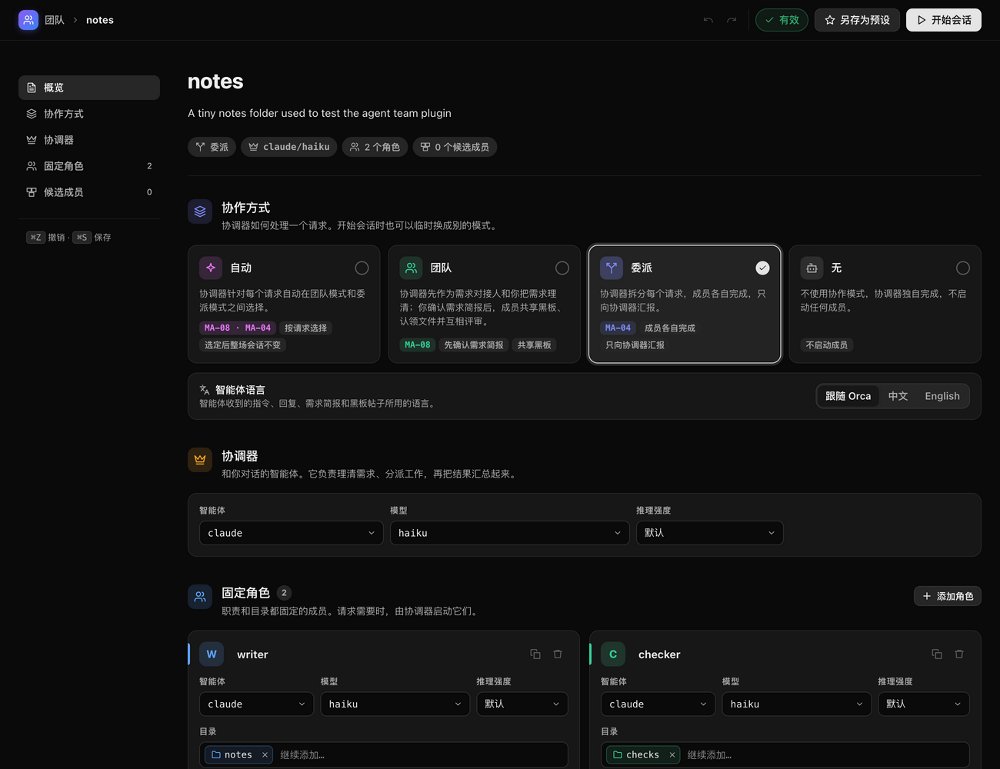

# Ensemble for Orca · Orca 智能体团队插件

**[English](#english)** · **[中文](#中文)**



---

## English

**Ensemble** runs a request with a team of coding agents in [Orca](https://github.com/stablyai/orca). A **lead** agent talks to you; **members** run in their own Orca terminals, each on its own agent CLI and model (Claude, Codex, Gemini, OpenCode, …). The lead works in one of two collaboration modes, or picks one per request:

| Mode | Pattern | How it goes |
| --- | --- | --- |
| **Team** | MA-08, shared board | Intake with you first (the lead restates the request and asks), then a brief and a task plan you confirm. Members share a task board (dependencies, atomic claims, the plugin hands ready tasks to idle members), post on a team board (questions, findings, answers), claim the files they edit, optionally get their plans approved, and review each other's done tasks in a review round. |
| **Delegation** | MA-04, orchestrator–workers | The lead splits the request into self-contained packets, one per role; each member works alone in its own context and reports only to the lead, who sums up. |
| **Auto** | | The lead picks team or delegation per request; the first run fixes the session to that mode. |
| **None** | | No members: the lead works alone. |

Everything the team does is recorded as a **data flow**: who wrote into which part of the mode (the brief, the task board, plan approval, the board, file claims; or the split, the sub-agent contexts, the reports and the summary) and what each part handed to whom. The plugin shows it live.

### Screenshots

**Task board** of a team run (Kanban by state, role filter, plans and sent-back tasks, the task's history):



**Delegation run**: task split, sub-agent contexts, reports and the lead's summary:



**Ensemble panel** in the right sidebar: the brief waiting for your confirmation, the data flow, and a page per component (task board, team board with read progress):



**Team editor** for `.agents/teams/*.team.json`:



<sub>Some screenshots show a generated demo run; the Chinese ones below were taken in Orca during real runs.</sub>

### What you get in Orca

- **Ensemble panel** (right sidebar, robot icon): the focused workspace's team session, its mode (switch it, or see it locked), the brief waiting for your **Confirm**, the members with their live state (click to show a member's terminal), and the run's data-flow diagram with a page per component.
  - **Start**: pick a team file of the project or a preset, write the request, choose this workspace or a **new worktree**, the mode and the language; or make an agent already running here the lead.
  - **Teams**: the project's team files (open one in the team editor), create a team, **plan a team with AI** (an agent reads the project, checks which agent CLIs you have and writes the team file), and the presets.
- **Team editor**: `.agents/teams/*.team.json` files open in a visual editor (Orca's Source view still shows the JSON): mode cards, language, the lead's agent/model/effort, fixed roles (folders, instructions) and the candidate pool (described by what each is good at and must not do), inline validation, undo/redo, **Save as preset**, **Start a session**.
- **Run report**: a full-width tab per run: the data-flow diagram, members, a Kanban task board, the brief, plans, a chat-like team board with read progress, file claims; for delegation the split, sub-agent contexts, reports and summary.
- **`@team` in Orca's own new agent**: start any agent in terminal mode with a first prompt such as

  ```
  @team web auto
  Add a dark mode toggle to the settings page
  ```

  and it becomes the lead of the team `web` (a team file or preset name; optional when the project has one team), in the given mode (optional). Turn it off in Settings → Plugins → Ensemble.
- **Status bar**: active runs, working members and briefs waiting for you; click to open the latest run report.
- **Chinese or English**: set per team (or follow Orca's language): the plugin's instructions to the agents, their replies, briefs and board posts, and the plugin's own UI.

### How it works

Orca plugins can't give agents new tools, so the plugin puts a command, `agent-team`, on the PATH of every agent Orca starts (an `agent.launch.before` hook). The lead runs `agent-team status`, `agent-team delegate '<json>'`, `agent-team brief`, `agent-team kickoff`, `agent-team wait`, …; members run `agent-team read`, `task`, `post`, `claim`, `report`. Each call goes over a Unix socket to the plugin's worker, which knows the caller by its Orca terminal (`ORCA_TERMINAL_HANDLE`). `agent-team help [command]` lists the commands and their JSON fields.

- Members start with `orca agent launch` (terminal surface, the role's model and effort) in the lead's checkout; the launch hook ties each launch to its terminal and gives Claude its standing instructions as an appended system prompt (other agents get them in their first message).
- Messages to idle agents are typed with `orca terminal send`, never into an agent mid-turn. Messages to a busy agent arrive in the output of its next `agent-team` command.
- Turn ends come from Orca's agent status and, for Claude, its session transcript (`stop_reason: end_turn`), so an agent's idle status while it starts up is not taken for a finished turn.
- Team mode's intake can't be skipped: `agent-team kickoff` needs your own words confirming the brief, found in the lead's transcript or on its screen after the brief was recorded, or your **Confirm** in the panel.
- State lives in `~/.orca-ensemble/<plugin>/` (sessions and runs). Team files live in the project, `.agents/teams/*.team.json`, shared through git. A run report opens on a small link file in `.agents/runs/`, which the plugin keeps out of git.

### Requirements

- **Orca 1.4.259 or later** (plugin host API 1.9). Older Orca can't load this plugin.
- Node.js on the PATH for the `agent-team` command (Orca's bundled runtime is used as a fallback).
- Agents in **terminal mode**. Orca's Chat UI sessions don't run launch hooks, so `@team` and `agent-team` work only in terminal agents; the panel always starts terminal agents.
- Local workspaces. SSH and remote Orca servers are not supported yet.

### Install

```sh
orca plugin install https://github.com/DueGin/orca-ensemble
```

or Orca → Settings → Plugins → install from the Git URL above. Review and enable it: it asks for workspace, agent, terminal, notification and storage access. `dist/` is committed, so a Git install needs no build.

From a folder (development):

```sh
npm install
npm run build
orca plugin dev load .        # asks you to approve its access once
```

### Team file

```json
{
  "version": 1,
  "name": "web",
  "goal": "Ship features in the web app end to end",
  "mode": "auto",
  "language": "en",
  "lead": { "agent": "claude", "model": "opus", "effort": "high" },
  "roles": [
    { "name": "frontend", "agent": "claude", "model": "sonnet", "folders": ["web/src"], "instructions": "Builds the React UI." },
    { "name": "backend", "agent": "codex", "model": "gpt-5.5-codex", "folders": ["api"], "instructions": "Owns the HTTP API." }
  ],
  "candidates": [
    { "name": "", "agent": "gemini", "model": "gemini-2.5-flash", "notes": "Good at: quick research, reading large files\nDo not give it: changes to the API" }
  ]
}
```

Roles own stable areas; candidates are a pool the lead assigns work to by their notes (and treats "do not give it" as a hard rule). Either may be empty, not both. `model` and `effort` are optional (the CLI's defaults). `language` is `zh`, `en`, or left out to follow Orca.

### Development

```sh
npm run typecheck && npm test   # unit tests, including a fake Orca that runs both modes end to end
npm run watch                    # rebuild dist/ on change; Orca reloads a development plugin
```

Layout: `src/worker/` (the plugin worker: hooks, the `agent-team` server, runs, the panel API), `src/cli/agent-team.ts` (the command), `src/shared/` (run model, task board, data flow, prompts in English and Chinese), `src/ui/` (panel, team editor and run report frames, React), `dev/` (static harnesses for the UI with a fake `window.orca`).

---

## 中文

**Ensemble** 在 [Orca](https://github.com/stablyai/orca) 里用一个智能体团队完成需求。你只和**协调器**对话；**成员**各自运行在自己的 Orca 终端里，每个角色用自己的 agent CLI 和模型（Claude、Codex、Gemini、OpenCode……）。协调器按下面的协作模式工作，也可以按需求自动选择：

| 模式 | 模式编号 | 过程 |
| --- | --- | --- |
| **团队** | MA-08，共享黑板 | 先需求对接：协调器复述需求、提问，再写出需求简报和任务计划，由你确认。成员共用任务板（依赖、原子认领、插件把就绪任务派给空闲成员），在团队黑板上提问、报告问题、回答，认领要改的文件，可选计划审批，最后一轮互相评审已完成的任务。 |
| **委派** | MA-04，编排者-执行者 | 协调器把需求拆成独立的任务包，每个角色一个；成员各自在自己的上下文里完成，只向协调器汇报，协调器汇总。 |
| **自动** | | 协调器按需求选择团队或委派；第一次运行后整个会话固定为该模式。 |
| **无** | | 不启动成员，协调器独自完成。 |

团队的每一步都会记录成**数据流**：谁写入了模式的哪个组件（需求简报、任务板、计划审批、黑板、文件认领；或任务拆分、子智能体上下文、结果汇报、汇总），以及组件交给了谁。插件实时展示。

### 截图

在 Orca 里打开的**运行报告**（一次真实的团队运行）：成员、数据流图、最近的数据流，下方按组件分页：



浅色主题下的运行报告：



右侧边栏的**「智能体团队」面板**（Orca 中实拍）和**团队编辑器**：

<p>


</p>

### 在 Orca 里能看到的

- **「智能体团队」面板**（右侧边栏，机器人图标）：当前工作区的团队会话、协作模式（可切换，自动模式确定后显示锁定）、等你**确认**的需求简报、成员及实时状态（点击可打开成员终端）、运行的数据流图，每个组件都能点进详情。
  - **开始**：选项目里的团队文件或预设，写需求，选择在当前工作区或**新建 worktree**、模式和语言；也可以把当前工作区里已经在运行的 agent 设为协调器。
  - **团队**：项目里的团队文件（在团队编辑器里打开）、新建团队、**用 AI 规划团队**（一个 agent 阅读项目、查看你装了哪些 agent CLI，然后写出团队文件），以及预设。
- **团队编辑器**：`.agents/teams/*.team.json` 会用可视化编辑器打开（Orca 的 Source 视图仍可看 JSON）：模式卡片、语言、协调器的 agent / 模型 / 推理强度、固定角色（目录、说明）和候选成员池（写清擅长什么、不要交给它什么），即时校验、撤销重做、**另存为预设**、**开始会话**。
- **运行报告**：每次运行一个全宽页面：数据流图、成员、看板式任务板、需求简报、计划审批、带已读进度的聊天式黑板、文件认领；委派模式下是任务拆分、子智能体上下文、结果汇报和汇总。
- **在 Orca 自带的新建 agent 里用 `@team`**：以终端模式新建任意 agent，第一条消息这样写：

  ```
  @team web auto
  给设置页加一个深色模式开关
  ```

  它就会成为团队 `web`（团队文件或预设的名字；项目里只有一个团队时可省略）的协调器，模式可选。可在 设置 → 插件 → Ensemble 里关闭。
- **状态栏**：进行中的运行、工作中的成员、等你确认的简报；点击打开最新的运行报告。
- **中文或英文**：按团队设置（或跟随 Orca 的界面语言），影响插件给智能体的指令、它们的回复、简报和黑板帖子，以及插件自己的界面。

### 原理

Orca 插件不能给 agent 加工具，所以插件通过 `agent.launch.before` 钩子把一个命令 `agent-team` 放进 Orca 启动的每个 agent 的 PATH。协调器运行 `agent-team status`、`agent-team delegate '<json>'`、`brief`、`kickoff`、`wait`……，成员运行 `read`、`task`、`post`、`claim`、`report`。每次调用经 Unix socket 发给插件的 worker，worker 按调用者所在的 Orca 终端（`ORCA_TERMINAL_HANDLE`）识别身份。`agent-team help [命令]` 列出命令和 JSON 字段。

- 成员用 `orca agent launch`（终端模式、角色的模型和推理强度）启动在协调器的检出目录里；启动钩子把每次启动和它的终端对应起来，并以追加系统提示的方式给 Claude 常驻指令（其他 agent 在第一条消息里收到）。
- 给空闲 agent 的消息用 `orca terminal send` 输入，绝不打断进行中的回合；给忙碌 agent 的消息会附在它下一次 `agent-team` 命令的输出里。
- 回合结束依据 Orca 的 agent 状态，Claude 还会读取它的会话记录（`stop_reason: end_turn`），不会把启动时的空闲状态误当成完成。
- 团队模式的需求对接不能跳过：`agent-team kickoff` 需要你在简报之后亲口确认的原话（从协调器的会话记录或屏幕里核对），或你在面板里按**确认**。
- 状态保存在 `~/.orca-ensemble/<plugin>/`。团队文件保存在项目里的 `.agents/teams/*.team.json`，通过 git 共享。运行报告打开的是 `.agents/runs/` 下的小链接文件，插件会把它排除在 git 之外。

### 要求

- **Orca 1.4.259 或更新**（插件宿主 API 1.9）。旧版 Orca 无法加载。
- `agent-team` 命令需要 PATH 里有 Node.js（没有时用 Orca 自带的运行时）。
- agent 使用**终端模式**。Orca 的 Chat UI 会话不经过启动钩子，`@team` 和 `agent-team` 只在终端 agent 里可用；面板启动的总是终端 agent。
- 仅本地工作区。暂不支持 SSH 和远程 Orca 服务器。

### 安装

```sh
orca plugin install https://github.com/DueGin/orca-ensemble
```

或在 Orca → 设置 → 插件 里用上面的 Git 地址安装，查看并启用（它会请求工作区、agent、终端、通知和存储权限）。`dist/` 已提交到仓库，从 Git 安装无需构建。

从本地目录安装（开发）：

```sh
npm install
npm run build
orca plugin dev load .        # 第一次需要批准权限
```

### 团队文件

格式见上方英文部分的 [Team file](#team-file)。固定角色负责项目中稳定的区域；候选成员是一个模型池，协调器按描述分工（"不要交给它"的工作一律不给）。两者可以只有其一，但不能都为空。`model` 和 `effort` 可省略（用该 CLI 的默认值）；`language` 填 `zh`、`en`，或省略以跟随 Orca。

### 开发

```sh
npm run typecheck && npm test   # 单元测试，包括用模拟的 Orca 把两种模式各跑一遍
npm run watch                    # 改动后重新构建 dist/；Orca 会重载开发中的插件
```

## License

MIT
